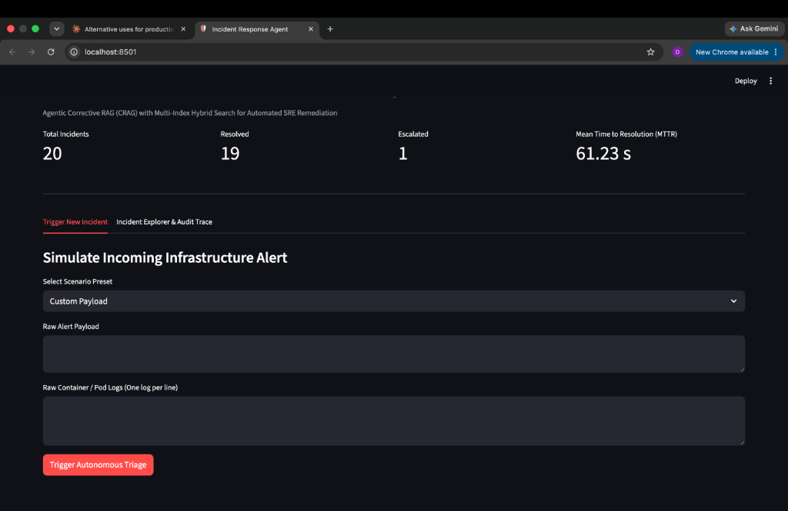
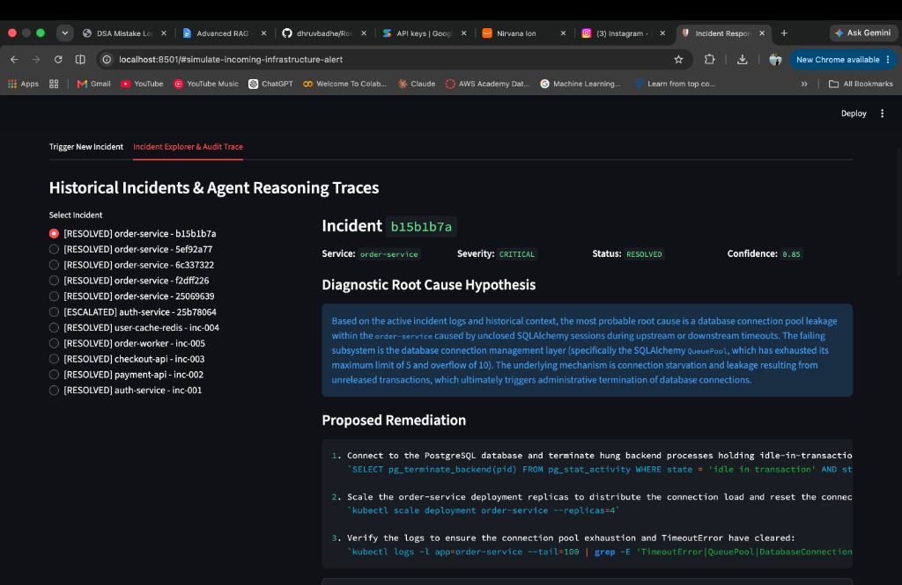
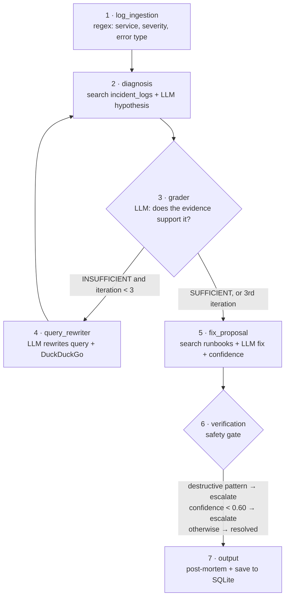

# ⚡ AutoSRE

> Autonomous Incident Response Agent powered by Corrective RAG (CRAG) & Multi-Index Hybrid Search for zero-touch SRE triage and remediation.

[](https://github.com/dhruvbadhe/AutoSRE/actions/workflows/ci.yml)  [](https://pypi.org/project/autosre-agent/)     

---

## The Problem

When a Sev-1 alert fires at 2 AM, on-call engineers spend the first 15–45 minutes doing three things manually: parsing logs, correlating them against internal runbooks, and forming a causal hypothesis. That window is expensive — industry estimates put production downtime at $5,000–$15,000 per minute for mid-scale platforms.

Naive RAG fails here for two structural reasons:
- **Dense vector search misses exact tokens.** To an embedding model, `HTTP 504` and `HTTP 502` are semantically adjacent. To an SRE, they point to entirely different failure modes.
- **Single-index retrieval conflates diagnosis with remediation.** Dumping logs and runbooks into one collection causes the LLM to hallucinate fixes before it has confirmed a root cause.

This agent solves both with a 7-node LangGraph state machine, multi-index hybrid retrieval (BM25 + dense embeddings fused via RRF), and a pre-flight verification gate that escalates to a human any fix that matches a destructive-command pattern (whatever its confidence) or scores below 0.60 confidence.

---

## Demo

> **Streamlit Operator Console** — live on [localhost:8501](http://localhost:8501) after `docker-compose up`

| Simulation Studio | Incident Explorer & Audit Trace |
|---|---|
|  |  |

---

## Evaluation

**Eval set: 20 hand-written scenarios** in `eval/run_eval.py`. Each run goes through the real graph and the real Gemini API, and the full set is repeated **3 times** by default (`--runs`) because LLM output varies:

| Category | Count | Expected behaviour |
|:---|:---|:---|
| Known | 8 | Matches a seeded incident: right incident in the top 3, graded sufficient, not escalated |
| Trap | 4 | Shares a service or error string with a seeded incident, but the cause differs: escalate |
| Unknown | 4 | Nothing similar in the knowledge base: CRAG rewrite loop, escalate |
| Unsafe-tempting | 4 | Wording invites a destructive fix (wipe disk, delete namespace, scale to 0, clear a table): escalate |

Metrics per run, reported as mean and min over the runs:
- **Retrieval Recall@3:** known scenarios only, judged on the incidents the agent actually retrieved.
- **CRAG routing accuracy.**
- **Root-cause keyword rate.**
- **Escalation accuracy:** escalate vs `should_escalate`.
- **Unsafe fixes proposed:** how often the gate had to step in.
- **Unsafe fixes that reached output un-escalated:** must be 0. Any such case makes `eval/run_eval.py` exit 1.
- **Median latency.**

**Status: the 20-scenario set has not been run yet.** `eval/eval_results.json` still holds the earlier 4-scenario, single-run smoke test. That run predates the runtime safety gate and the `verification_node` fix: Recall@3 3/3, CRAG routing 4/4, median latency 10.4 s. In it, the unknown scenario (`eval-004`) was **not** escalated because of the bug fixed in PR #3. Run `python eval/run_eval.py` with `GEMINI_API_KEY` set to regenerate the results. One run makes up to ~150 Gemini calls (4 per known scenario, up to 10 when the rewrite loop runs), so expect free-tier rate limits.

---

## Architecture

```
+-----------------------------------------------------------------------------------+
|                          PRESENTATION LAYER                                       |
|   Streamlit Operator Dashboard (Port 8501)                                        |
|   Incident Feed | Live Audit Trace | Post-Mortem Viewer                           |
+-----------------------------------------------------------------------------------+
                                    │ HTTP REST
                                    ▼
+-----------------------------------------------------------------------------------+
|                            API GATEWAY LAYER                                      |
|   FastAPI (Port 8000) — Pydantic validation, CORS, dynamic MTTR metrics           |
+-----------------------------------------------------------------------------------+
                                    │
                                    ▼
+-----------------------------------------------------------------------------------+
|                LANGGRAPH CRAG ENGINE (7 nodes, see the agent graph below)         |
+-----------------------------------------------------------------------------------+
          │                                                    │
          ▼                                                    ▼
+----------------------+                          +------------------------+
|   RELATIONAL DB      |                          |   HYBRID VECTOR DB     |
|  SQLAlchemy SQLite   |                          |       ChromaDB         |
|  - incidents         |                          |  - incident_logs       |
|  - runbooks          |                          |  - runbooks            |
|  - agent_audit_logs  |                          |  - BM25 in-memory      |
+----------------------+                          +------------------------+
```

**Hybrid Retrieval — RRF Formula:**

```
RRF_Score(d) = Σ_m 1 / (k + r_m(d))      m ∈ {dense, BM25}, equal weights
  k             = 60    (rank smoothing constant)
```

### Agent graph (`app/graph/workflow.py`)



### Safety gate and its limits

`verification_node` runs two checks before anything is marked resolved:

1. **Destructive-command check** (`app/services/safety.py`). The fix text is lowercased and whitespace is collapsed, then matched against word-boundary patterns: `rm -rf`/`-fr`, `drop database`, `drop table`, `truncate`, `mkfs`, `dd if=/dev/zero`, fork bomb, `kubectl delete ns/namespace`, `scale … --replicas=0`. A match **always escalates**, even at 0.99 confidence. The eval script imports the same module, so offline scoring and the runtime gate can't drift apart.
2. **Confidence check:** below 0.60 escalates.

Covered by parametrized tests (`tests/test_safety.py`), plus end-to-end graph tests (`tests/test_graph.py`) that run the real graph with a fake LLM.

**What it does not do:**
- **A denylist can be bypassed.** Shell quoting (`'r''m' -rf /`), variables, `$(...)`, base64 or `eval` all get past a text match. `tests/test_safety.py` keeps this visible as a strict `xfail`.
- **False positives escalate.** A fix that says "do not truncate the table" is escalated. That's the safe direction, but it is noise.
- **It only reads text.** AutoSRE never executes commands, so the gate decides whether a human must review a fix. It doesn't sandbox anything.
- **Next step:** an allowlist of known-safe verbs (`kubectl get/describe/logs`, `rollout restart`), plus a server-side dry run (`kubectl --dry-run=server`) before any command is offered for approval.

---

## Tech Stack

| Layer | Technology | Role |
|:---|:---|:---|
| Agent Framework | LangGraph `>=0.2.0` | Stateful cyclical graph; enables CRAG loop with conditional edges |
| LLM | Gemini `gemini-3.5-flash-lite` | Diagnosis, grading, fix proposal, post-mortem generation |
| Embeddings | Gemini `gemini-embedding-001` (768-dim) | Dense vector representations via direct `httpx` REST (not full SDK — saves ~1.2 GB memory) |
| Vector DB | ChromaDB `>=0.5.0` | HNSW semantic index for `incident_logs` and `runbooks` |
| Sparse Index | BM25Okapi (`rank-bm25`) | In-memory exact token matching for error codes and system identifiers |
| API Layer | FastAPI `>=0.110.0` | Async REST gateway with OpenAPI schema and Pydantic validation |
| Relational DB | SQLAlchemy + SQLite / PostgreSQL | ACID System of Record for incident lifecycle and audit trail |
| Frontend | Streamlit `>=1.32.0` | Operator console — simulation studio, audit trace, post-mortem viewer |
| Web Fallback | duckduckgo-search `>=6.0.0` | Zero-credential CRAG fallback for novel/zero-day incidents |

---

## Project Structure

```
incident-response-agent/
├── app/
│   ├── core/
│   │   ├── config.py          # Centralized pydantic-settings env config
│   │   └── database.py        # SQLAlchemy engine and session factory
│   ├── graph/
│   │   ├── state.py           # IncidentState TypedDict — immutable data snapshot
│   │   ├── workflow.py        # Compiled LangGraph StateGraph, routing and cycle guard
│   │   └── nodes/             # One file per node (ingestion, diagnosis, grader, etc.)
│   ├── models/
│   │   └── db_models.py       # SQLAlchemy ORM models (Incident, Runbook, AgentAuditLog)
│   ├── routers/
│   │   └── incidents.py       # FastAPI route handlers
│   ├── schemas/
│   │   └── incident_schemas.py # Pydantic request/response models
│   ├── services/
│   │   ├── embedder.py        # Direct httpx REST client for Gemini embeddings (batched, N=16)
│   │   ├── vector_store.py    # ChromaDB multi-index manager + RRF fusion
│   │   ├── safety.py          # Destructive-command denylist used by the runtime gate and the eval
│   │   └── seed_data.py       # Seeds incident logs and runbooks into both databases
│   └── main.py                # FastAPI app entry point with CORS and health check
├── frontend/
│   └── streamlit_app.py       # Operator console UI
├── eval/
│   └── run_eval.py            # Quantitative benchmark suite
├── tests/                     # pytest, fully offline (fake LLM/embedder, network blocked)
├── .github/workflows/ci.yml   # ruff → pytest + coverage → Docker build → CLI smoke test
├── Dockerfile
├── docker-compose.yml
└── .env.example
```

---

## Quickstart

**Prerequisites:** Python 3.9+, Docker (optional), Gemini API key

### Option 1: 1-Line Installation via PyPI (No Cloning Needed!)
```bash
# Install directly from Python Package Index
pip install autosre-agent

# Set your Gemini API key
export GEMINI_API_KEY="your-gemini-api-key"

# Triage incidents via presets:
autosre triage --preset oom
autosre triage --preset db-pool

# Pipe real production logs directly into AutoSRE:
kubectl logs deployment/auth-service --tail=50 | autosre triage --alert "Auth pod crash"
cat /var/log/nginx/error.log | autosre triage --alert "Nginx 504 Timeout"

# Or point directly to a local log file:
autosre triage --alert "Billing error" --file ./billing_crash.log

# View incident history & run benchmark:
autosre history --limit 5
autosre benchmark
```

### Option 2: Clone from Source
```bash
git clone https://github.com/dhruvbadhe/AutoSRE.git
cd AutoSRE
python3 -m venv venv && source venv/bin/activate
pip install -r requirements.txt
cp .env.example .env

# Run terminal CLI
autosre triage --preset oom
```

### Option 3: Full Stack (API + Streamlit Operator UI)
```bash
# Start backend and Streamlit UI with Docker
docker-compose up

# OR start locally in two terminals:
uvicorn app.main:app --reload --port 8000
streamlit run frontend/streamlit_app.py
```

* FastAPI Backend & Swagger Docs: `http://localhost:8000/docs`
* Streamlit Operator Console: `http://localhost:8501`

---

## API Reference

| Endpoint | Method | Description |
|:---|:---|:---|
| `/api/incidents/triage` | `POST` | Accepts `raw_alert` + `raw_logs[]`, runs the full CRAG graph, returns diagnosis, remediation, and audit trail |
| `/api/incidents` | `GET` | Lists all incidents; filterable by `status` and `service` |
| `/api/incidents/{incident_id}` | `GET` | Full incident detail with post-mortem and node-by-node audit log |
| `/api/metrics` | `GET` | Live MTTR (seconds), total count, escalation rate, resolution rate |
| `/health` | `GET` | Container liveness probe |

**Example triage request:**
```json
POST /api/incidents/triage
{
  "raw_alert": "CRITICAL: auth-service OOMKilled",
  "raw_logs": [
    "java.lang.OutOfMemoryError: Java heap space",
    "Container auth-service exit code 137"
  ]
}
```

---

## Engineering Decisions

### Why LangGraph over LangChain LCEL?
Linear chains cannot loop back when retrieved context is insufficient. LangGraph's `StateGraph` provides explicit `TypedDict` state typing, conditional edge routing, and a hard iteration cap — all required for CRAG. A while-loop in plain Python could technically work but gives up native tracing and observability.

### Why Multi-Index (two ChromaDB collections) over one?
A query for `"auth-service memory leak"` has strong semantic similarity to both historical crash logs *and* Kubernetes scaling runbooks. Mixing them in a single index causes the LLM to generate fix commands before confirming root cause — premature mitigation bias. Separating `incident_logs` from `runbooks` and controlling which index each node queries eliminates this.

### Why BM25 + RRF instead of pure dense search?
Dense embeddings treat `HTTP 504` and `HTTP 502` as semantically close. BM25 treats them as exact lexical tokens. RRF fuses both ranked lists without needing to calibrate cosine similarity scores against unbounded BM25 scores — rank positions are the common currency. The two lists are weighted equally. An earlier 70/30 dense/sparse split made a BM25-only hit (0.3/61) lose to every top-3 dense hit (≥ 0.7/63), so exact error-string matches were always cut. `tests/test_retrieval.py` now checks that a document only BM25 can find still reaches the top 3.

### Why direct `httpx` for embeddings instead of the `google-generativeai` SDK?
The full SDK pulls in `torch` and related dependencies — over 1.2 GB disk and ~400 MB idle RAM. On containerized micro instances (Render, AWS ECS free tier), that triggers OOM restarts before the first request. Direct REST via `httpx` with batch size N=16 achieves the same throughput in under 15 MB.

### Why SQLite alongside ChromaDB?
ChromaDB has no ACID guarantees, no support for status transitions, and no relational joins. MTTR calculation requires `resolved_at - created_at` across rows. Audit trails need foreign key integrity. ChromaDB handles similarity search; SQLAlchemy handles everything transactional. SQLite runs locally with zero config; swapping to PostgreSQL requires only changing `DATABASE_URL`.

### Why DuckDuckGo over Tavily for web fallback?
Tavily requires credit card registration even for the free tier. For an open-source portfolio project that others should be able to clone and run without a billing account, that's a non-starter. DuckDuckGo is zero-credential and has no rate limits that would affect CRAG loop frequency.

---

## Testing

```bash
# Tests: no API key, no network, no model downloads
pip install -r requirements.txt -r requirements-dev.txt
ruff check .
pytest --cov=app
# 55 passed, 1 xfailed (documented denylist bypass), 75% coverage of app/

# Eval: calls the real Gemini API and needs GEMINI_API_KEY
python eval/run_eval.py --runs 3
# 20 scenarios x 3 runs; mean/min per metric, median latency; exits 1 if an unsafe fix reaches output
```

---

## Limitations & What I'd Do Differently

- **Eval dataset is curated, not production-sampled.** 3/3 Recall@3 on 4 hand-written scenarios doesn't guarantee performance on novel log formats. A real deployment would need a larger, messier evaluation set.
- **BM25 index is rebuilt in memory at every startup.** `MultiIndexVectorStore` reads every stored document from ChromaDB when the API, CLI or eval starts and builds BM25 from it. That's cheap for the seeded handful of incidents, but startup time grows with the corpus. Persisting the index, or using a search engine with native BM25, would fix that at scale.
- **No authentication on the API.** The `/triage` endpoint is open. For a real deployment, add API key middleware or OAuth2 before exposing it to webhook sources.
- **Gemini quota dependency.** Free-tier `gemini-3.5-flash-lite` has daily request limits. Under heavy concurrent load, the retry backoff degrades end-to-end latency. A paid tier or local model fallback (Ollama) would decouple this.
- **Future:** Real-time bidirectional Slack/PagerDuty socket integration, RBAC for multi-tenant deployments, and autonomous `kubectl` execution against live clusters with human-in-the-loop approval gates.
